# FleetIQ

**Fleet maintenance risk and freight pricing, from raw CSV to a monitored service.**

FleetIQ is an end-to-end MLOps project for a logistics fleet. It ingests 250,000 maintenance records and 2,000 shipments, trains two models, promotes them through a quality gate, serves them through a typed API, and measures drift on live traffic.

The project covers the full path: warehouse, shared feature contract, experiment tracking, model registry, orchestration, tests, container deployment, and an operations dashboard.


[](https://github.com/Harkiran11/FleetIQ/actions/workflows/ci.yml)

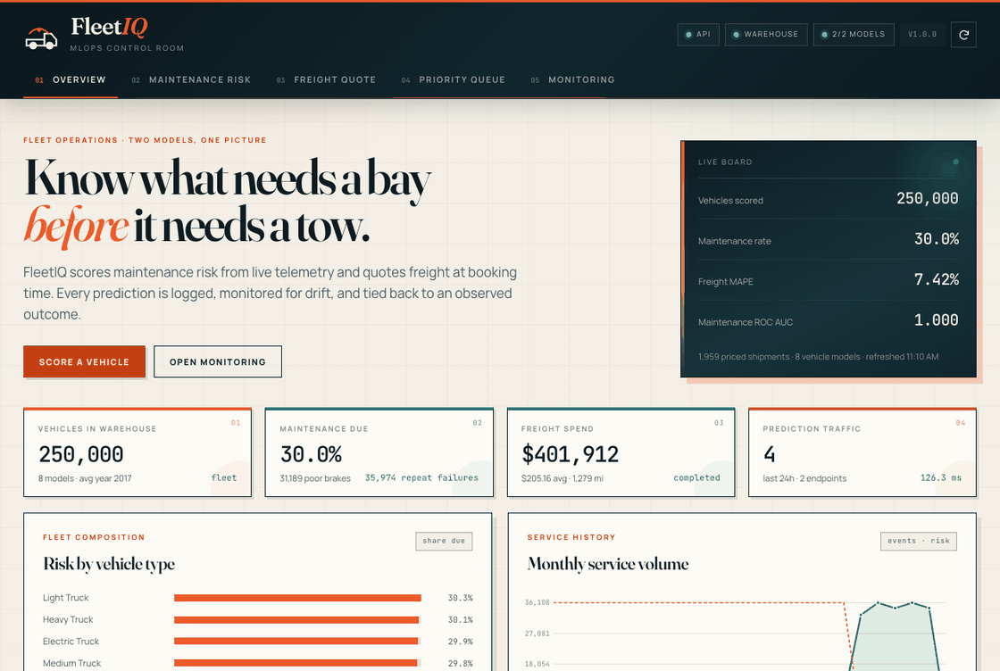

*Overview, maintenance scoring, freight quote, priority queue, and drift monitoring. Captured from the running app.*

## At a glance

| Area | Result |
| --- | --- |
| Data | 250,000 maintenance records and 2,000 shipments in a relational warehouse |
| Maintenance model | ROC AUC 1.000, PR AUC 1.000, F1 1.000 on 50,000 held-out rows |
| Freight model | MAE $13.15, MAPE 7.42%, R² 0.9616 |
| Interval calibration | 90.14% empirical coverage at a 90% nominal level |
| Baseline lift | Freight MAE fell from $30.02 to $13.15, a 56% reduction |
| Latency | p95 24.5 ms maintenance, 27.5 ms freight, 554 ms for a 30-vehicle priority queue |
| Quality | 111 tests pass, 69% coverage, ruff clean, Lighthouse 1.0 for accessibility |
| Deployment | SQLite locally, PostgreSQL and MLflow in Docker Compose |

## What it does

| Capability | Implementation |
| --- | --- |
| Warehouse | SQLAlchemy 2 models over SQLite locally and PostgreSQL in Compose |
| Maintenance risk | Histogram gradient boosting classifier, tuned threshold, risk bands, contributing signals |
| Freight pricing | Histogram gradient boosting regressor with absolute-error loss and split-conformal 90% intervals |
| Experiment tracking | MLflow runs, params, metrics, plots, signatures, registry versions, and a `champion` alias |
| Orchestration | Prefect 3 flows for refresh, ingest, train, and monitor, with cron deployments |
| Serving | FastAPI, batch endpoints, Pydantic contracts, compatibility aliases, Gunicorn in Docker |
| Monitoring | PSI drift against stored training distributions, traffic and latency summaries, human feedback loop |
| Dashboard | Operations console in plain HTML, CSS, and JavaScript with no build step |
| Quality | 111 pytest tests, ruff lint and format, coverage, GitHub Actions, Docker health checks |

## Results

Both models are committed under `models/` with their metadata, model cards, and evaluation plots. MLflow tracked the runs during training, and the run IDs below match the bundles to the experiments.

### Maintenance risk

| Metric | Value |
| --- | --- |
| MLflow run | `13a23254c21e4a20a3b542e756362793` |
| Registry version | `1` with alias `champion` |
| Train, validation, test | 175,000, 25,000, 50,000 |
| ROC AUC | 1.0000 |
| PR AUC | 1.0000 |
| F1, precision, recall | 1.0000, 1.0000, 1.0000 |
| Brier score | 2.63e-12 |
| Log loss | 1.49e-06 |
| Baseline ROC AUC, F1 | 0.5000, 0.0000 |
| Test confusion (TN, FP, FN, TP) | 35,000, 0, 0, 15,000 |
| Tuned threshold | 0.9999975253 |
| Features | 36, split into 26 numeric and 10 categorical |

The public maintenance dataset is synthetic, and the target is a deterministic function of service state. Near-perfect metrics are a property of the data, not a claim about production fleet performance. The model deliberately excludes `days_since_last_maintenance`, `maintenance_severity`, `predictive_score`, `maintenance_cost`, `downtime_maintenance`, `data_split`, and the derived reliability indices. The exclusion list is asserted by a test and recorded in every model card.

### Freight pricing

| Metric | Value |
| --- | --- |
| MLflow run | `792c772cfb53478fab3cd443fcd5e50e` |
| Registry version | `1` with alias `champion` |
| Train, validation, test | 1,371, 294, 294 |
| MAE | $13.15 |
| Median absolute error | $10.62 |
| RMSE | $18.01 |
| MAPE | 7.42% |
| R² | 0.9616 |
| 90% interval coverage | 90.14% |
| Baseline MAE, MAPE | $30.02, 16.64% |
| Residual quantiles (0.8, 0.9, 0.95) | 18.92, 28.43, 34.31 |
| Features | 13 booking-time features |

The freight model only sees information available when the quote is made. `cost`, `delivery_date`, `status`, `transit_days`, and `shipment_id` are excluded. The interval is a split-conformal residual quantile, not a Gaussian assumption.

### Evaluation charts

| Maintenance confusion matrix | Freight predicted vs actual |
| --- | --- |
| 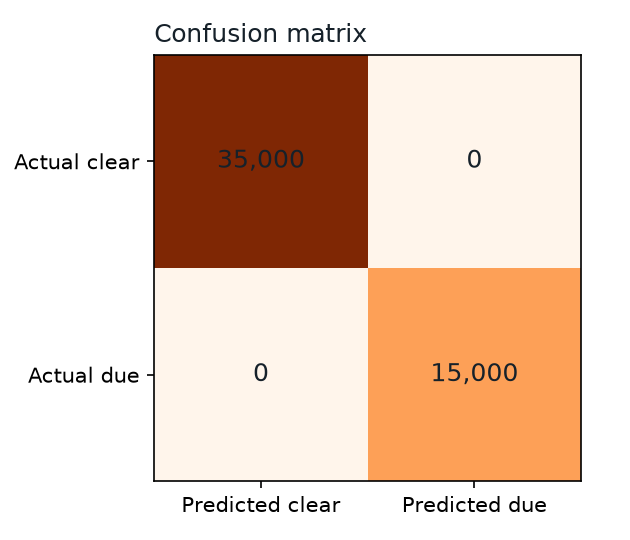 | 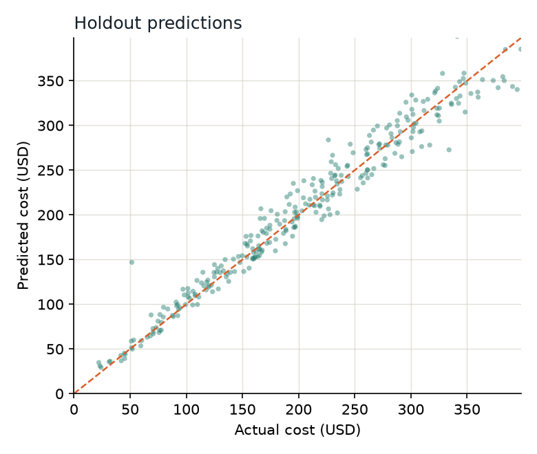 |

| Maintenance feature importance | Freight residuals |
| --- | --- |
| 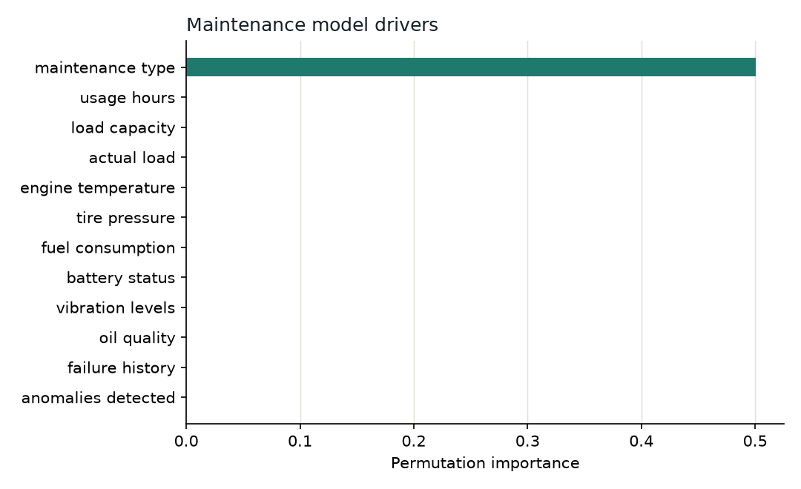 | 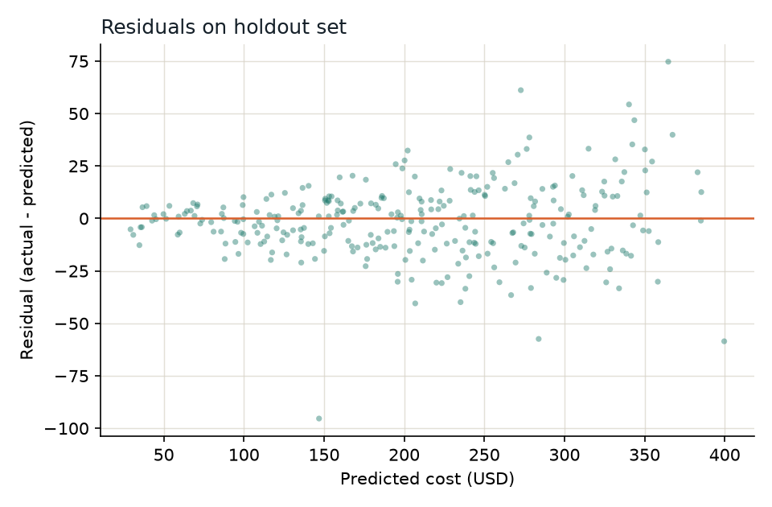 |

The calibration curve and additional plots are written to `data/processed/plots/` after training. Selected plots are embedded above and copied into `docs/images/`.

## Architecture

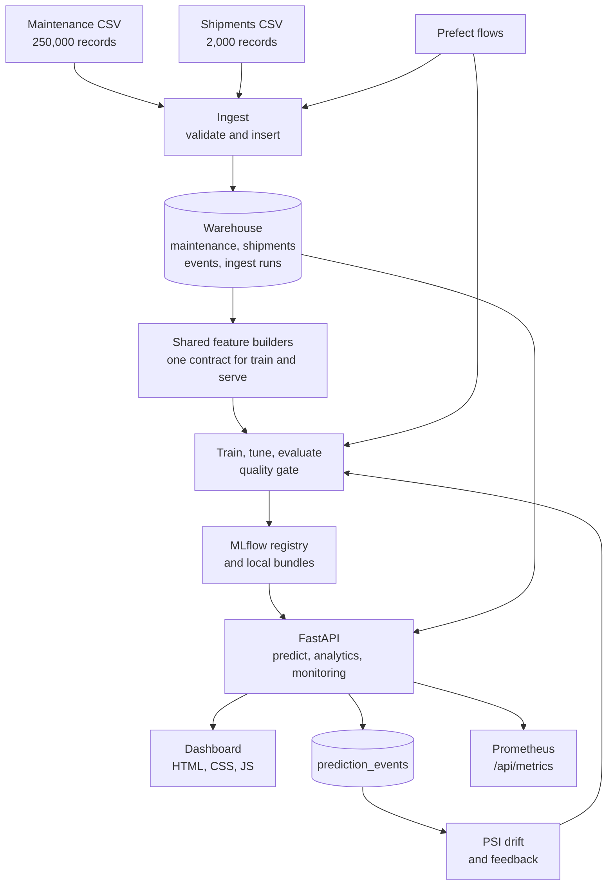

Prefect calls the same functions as the CLI, so a flow is never a second implementation of the pipeline. The API reads local bundles by default and can switch to the MLflow `champion` alias with `MODEL_SOURCE=mlflow`.

## ML lifecycle

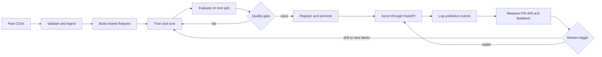

The quality gate blocks promotion when maintenance ROC AUC drops below 0.75 or freight MAPE rises above 25%. Both limits are configurable. Promotion writes a local bundle, creates an MLflow version, and sets the `champion` alias to the new version.

## Data model

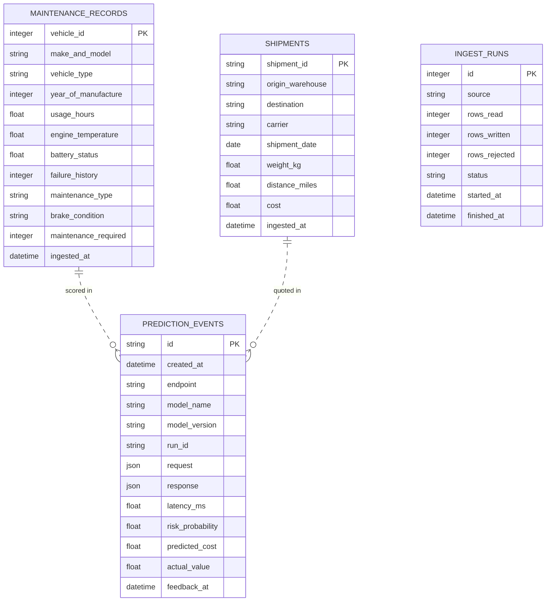

`prediction_events` is the observability backbone. Each row stores the request, response, model version, run ID, latency, and optional realised outcome. The dotted links are logical, not foreign keys, because the request payload is stored as JSON. The full column list is in [docs/architecture.md](docs/architecture.md).

## Inside the dashboard

| Maintenance risk | Freight quote |
| --- | --- |
| 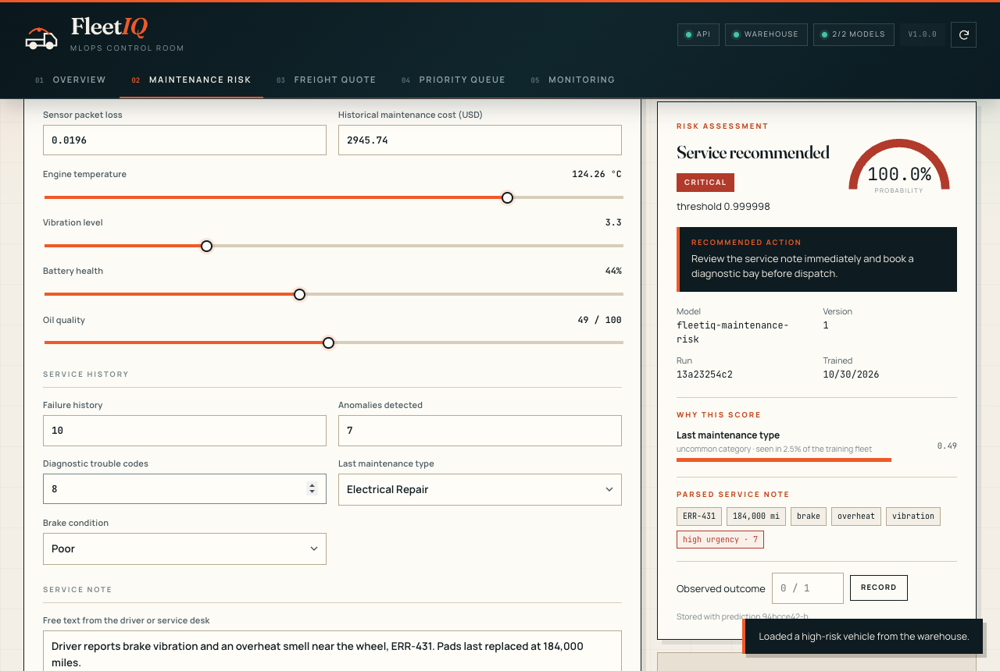 | 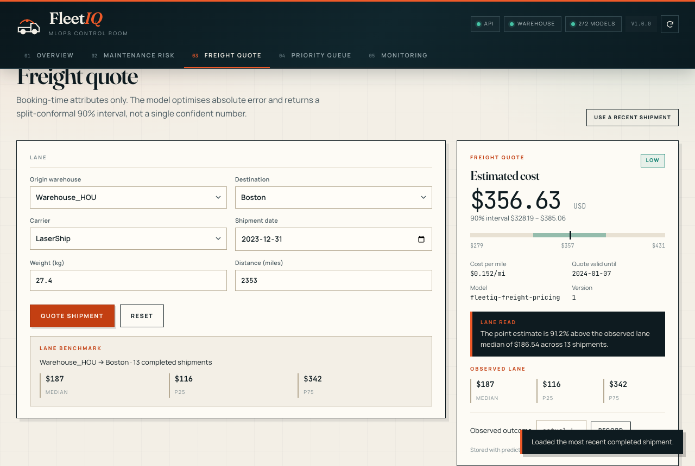 |

| Priority queue | Drift monitoring |
| --- | --- |
| 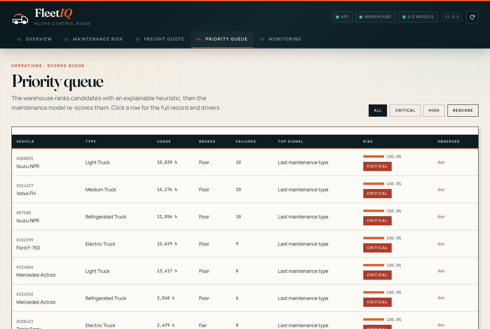 | 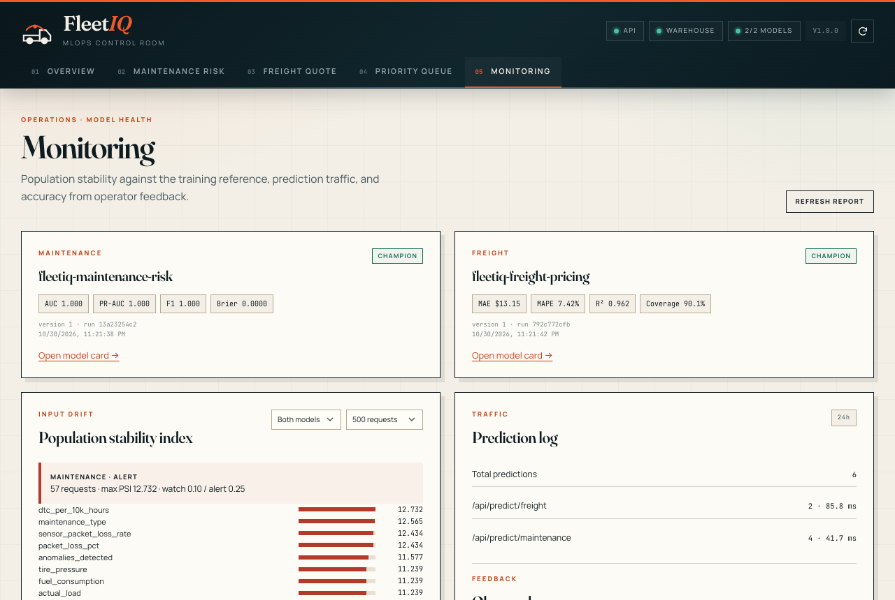 |

The dashboard is served by FastAPI at `/`. It has no Node build step and no frontend framework.

## Quickstart

### 1. Install

```bash
python3.13 -m venv .venv
source .venv/bin/activate
python -m pip install --upgrade pip
python -m pip install -r requirements-dev.txt
```

With `uv`:

```bash
uv venv --python 3.13 .venv
uv pip install --python .venv/bin/python -r requirements-dev.txt
```

### 2. Add the source CSVs

```text
data/raw/logistics_predictive_maintenanceV2.csv   250,000 maintenance records
data/raw/logistics_shipments_dataset.csv          2,000 shipments
```

The loader also checks `archive/` and the project root, but `data/raw/` is the expected location. The CSVs are not committed because of size.

### 3. Ingest, train, and serve

```bash
cp .env.example .env
python -m src.cli ingest --force
python -m src.cli train --model all
python -m src.cli serve --reload
```

Open <http://localhost:8000>. The API docs are at `/docs`.

Training writes MLflow runs and metrics, registry versions, local bundles under `models/<key>/current/`, model cards, reference distributions, and evaluation plots.

### 4. Explore MLflow

```bash
mlflow ui --backend-store-uri sqlite:///./mlflow.db --port 5001
```

Open <http://localhost:5001> to see both experiments and registered models.

### Run the dashboard without the full dataset

The repository includes a 5,000-row fixture warehouse and small model bundles for tests. They also work for a quick local demo:

```bash
DATABASE_URL=sqlite:///./data/test_fleetiq.db \
MODEL_DIR=models_test \
python -m src.cli serve
```

## Docker Compose

```bash
docker compose up --build -d
docker compose logs -f api
```

Open <http://localhost:8000>. On first boot the entrypoint detects an empty warehouse and ingests `data/raw/` into PostgreSQL. The image contains the promoted bundles, so serving does not wait for training.

| Service | Port | Purpose |
| --- | --- | --- |
| `api` | 8000 | FastAPI, Gunicorn, and the dashboard |
| `mlflow` | 5000 | MLflow tracking server and registry |
| `postgres` | 5432 | Warehouse and MLflow backend store |
| `init` | none | Optional one-shot ingest and train job (`--profile bootstrap`) |

```bash
docker compose run --rm init    # retrain and promote inside the stack
docker compose down             # stop, keep volumes
docker compose down -v          # stop and delete warehouse and MLflow state
```

## API

Canonical routes live under `/api`. Compatibility aliases such as `/predict`, `/health`, and `/models` exist for simple demos and are hidden from the OpenAPI schema.

### Maintenance score

```bash
curl -s http://localhost:8000/api/predict/maintenance \
  -H 'content-type: application/json' \
  -d '{
    "vehicle_id": 82468,
    "year_of_manufacture": 2015,
    "usage_hours": 18400,
    "load_capacity": 10000,
    "actual_load": 10105,
    "engine_temperature": 124.3,
    "tire_pressure": 23.9,
    "battery_status": 43.9,
    "vibration_levels": 3.32,
    "oil_quality": 48.6,
    "failure_history": 10,
    "anomalies_detected": 7,
    "diagnostic_trouble_code_count": 8,
    "maintenance_type": "Electrical Repair",
    "brake_condition": "Poor",
    "service_note": "Driver reports brake vibration and an overheat smell near the wheel, ERR-431. Pads last replaced at 184,000 miles."
  }'
```

The response contains the probability, threshold, risk band, recommended action, top contributing signals, parsed error codes and mileage, and the logged `prediction_id`.

### Freight quote

```bash
curl -s http://localhost:8000/api/predict/freight \
  -H 'content-type: application/json' \
  -d '{
    "origin_warehouse": "Warehouse_CHI",
    "destination": "Dallas",
    "carrier": "UPS",
    "shipment_date": "2025-03-18",
    "weight_kg": 38.9,
    "distance_miles": 1225
  }'
```

The response contains the point estimate, 90% interval, cost per mile, quote validity date, and the observed lane benchmark when history exists.

### Main endpoints

| Method | Path | Purpose |
| --- | --- | --- |
| GET | `/api/health` | Liveness, database, and model availability |
| GET | `/api/ready` | Readiness, returns 503 until both models load |
| GET | `/api/models` | Promoted model metadata and metrics |
| POST | `/api/predict/maintenance` | Single vehicle score |
| POST | `/api/predict/maintenance/batch` | Up to 500 vehicles |
| POST | `/api/predict/freight` | Single quote |
| POST | `/api/predict/freight/batch` | Up to 500 quotes |
| GET | `/api/analytics/overview` | Fleet, shipment, and traffic KPIs |
| GET | `/api/vehicles/priority` | Model-scored maintenance queue |
| GET | `/api/monitoring/drift` | PSI report from recent requests |
| GET | `/api/metrics` | Prometheus text exposition |
| POST | `/api/admin/reload` | Reload bundles or the MLflow champion |

Full request and response examples are in [docs/api.md](docs/api.md).

## Project layout

```text
fleet-iq-mlops/
├── api/
│   ├── main.py                 # app factory, lifespan, static dashboard
│   ├── deps.py                 # registry, database session, prediction logging
│   ├── schemas.py              # Pydantic contracts
│   └── routers/                # predictions, analytics, monitoring, system
├── src/
│   ├── config.py               # pydantic-settings configuration
│   ├── db.py                   # engine and session lifecycle
│   ├── db_models.py            # SQLAlchemy 2 models
│   ├── ingest.py               # CSV discovery, cleaning, batch inserts
│   ├── features.py             # shared feature builders, note parser, SQL analytics
│   ├── train.py                # training, evaluation, MLflow, bundles, plots
│   ├── predict.py              # maintenance and freight inference
│   ├── registry.py             # local bundles, promotion, MLflow loading
│   ├── monitoring.py           # PSI drift, traffic and feedback metrics
│   ├── analytics.py            # dashboard SQL
│   ├── pipeline.py             # Prefect flows and deployments
│   ├── storage.py              # optional S3 artefact mirror
│   └── cli.py                  # operational CLI
├── frontend/                   # dependency-free dashboard and bundled fonts
├── models/                     # promoted bundles and run history
├── tests/                      # 111 tests
├── docs/                       # architecture, walkthrough, API, runbook, UI, portfolio
├── docker/entrypoint.sh        # container bootstrap
├── Dockerfile
├── docker-compose.yml
├── Makefile
├── pyproject.toml              # pytest, coverage, ruff
└── requirements*.txt
```

Common `make` targets:

```bash
make install      # create .venv and install dependencies
make ingest       # load raw CSVs
make train        # train and register both models
make serve        # API with autoreload
make test         # pytest
make cov          # pytest with coverage
make lint         # ruff check
make format       # ruff format and safe fixes
make check        # lint and test
make docker-up    # Compose stack
make docker-init  # retrain inside Compose
```

## Design decisions

**One feature contract.** Training and serving import the same `prepare_maintenance_features` and `prepare_freight_features` functions. There is no notebook rewrite and no train/serve skew. Tests assert the output schema, including the missing-column case.

**Leakage is explicit.** The maintenance dataset contains post-service fields that would make the task trivial. `MAINTENANCE_EXCLUDED_COLUMNS` lists every excluded column, a test asserts the list, and each model card records it.

**Local bundles first.** The default serving path reads `models/<key>/current/`, so the API boots without MLflow. `MODEL_SOURCE=mlflow` switches to the registry alias. Both paths are tested.

**Monitoring uses training references.** Each bundle stores numeric bin edges, bin shares, and categorical frequencies. PSI compares live requests against those references, with a watch threshold at 0.10, an alert at 0.25, and a 25-request minimum window.

**No frontend build.** The dashboard is plain HTML, CSS, and JavaScript served by FastAPI. It removes Node from the deployment and keeps the UI easy to inspect.

**Tests use a fixture warehouse.** A 5,000-row database and small bundles under `models_test/` keep the suite near three seconds and independent of the full training run.

## Testing and quality

```bash
pytest tests -q
pytest tests -q --cov=src --cov=api --cov-report=term-missing
ruff check src api tests
ruff format --check src api tests
```

Current state:

- 111 tests pass in about 3 seconds
- 69% coverage overall, with serving, features, analytics, monitoring, and registry paths covered
- Ruff lint and format are clean, line length 100, target Python 3.11
- Lighthouse on the overview: Accessibility 1.0, Best Practices 1.0, SEO 1.0
- All 16 API endpoints returned 200 in a local smoke test

The two pytest warnings are upstream deprecations from Starlette's TestClient and FastAPI's `HTTP_413` constant.

## Limitations

- The maintenance dataset is synthetic. The near-perfect metrics are a property of the data, not evidence of real fleet performance.
- The freight dataset covers 2023 US lanes with 2,000 shipments. The model demonstrates the workflow, not a production pricing engine.
- SQLite is the local default. PostgreSQL runs in Docker, and the SQLAlchemy layer is portable, but the test suite exercises SQLite.
- MLflow uses `cloudpickle` serialization because skops blocks the histogram gradient boosting types used here.
- The Docker image build was not run during development because the local Docker daemon was unavailable. `docker compose config` validates, and CI builds and smoke tests the image.
- The dashboard is built for one product. If it grew into a multi-team tool, the next step would be a typed client and a component library.

## Documentation

| Document | Contents |
| --- | --- |
| [docs/architecture.md](docs/architecture.md) | Component architecture, data flow, schema, and trade-offs |
| [docs/walkthrough.md](docs/walkthrough.md) | How each module was built, including the bugs found during verification |
| [docs/api.md](docs/api.md) | Endpoint reference and curl examples |
| [docs/runbook.md](docs/runbook.md) | Retraining, rollback, drift response, and troubleshooting |
| [docs/ui.md](docs/ui.md) | Dashboard structure, design system, and accessibility notes |
| [docs/portfolio.md](docs/portfolio.md) | Resume bullets, interview notes, and a demo script |

## License

MIT. See [LICENSE](LICENSE). The datasets retain their original licenses. Check the source distribution before redistributing them.
