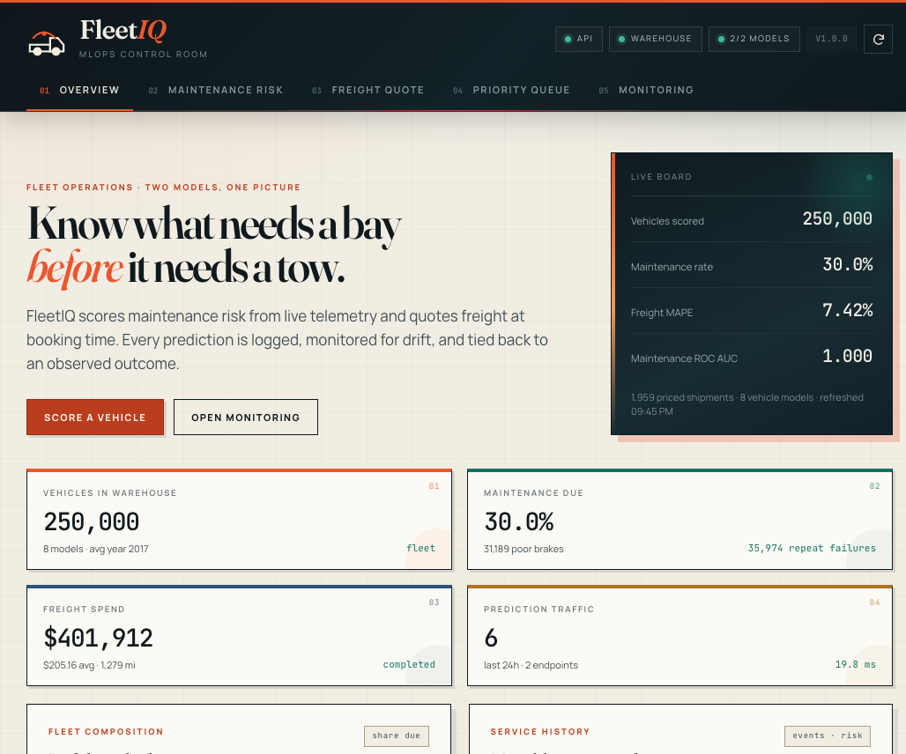
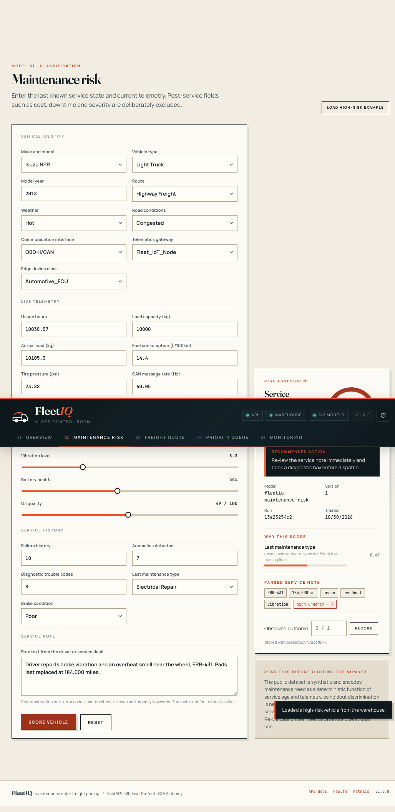
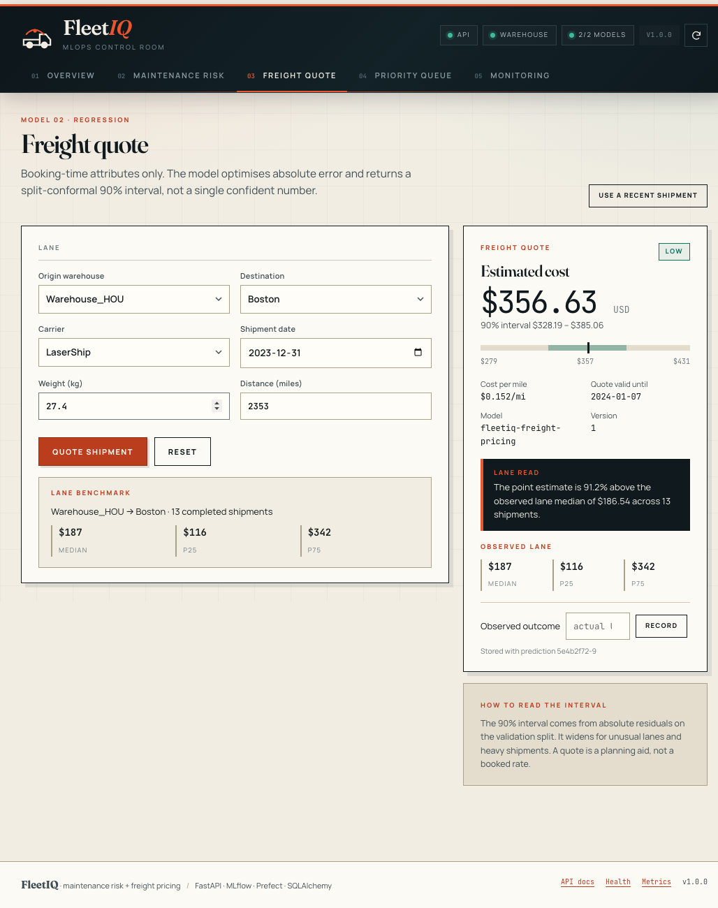
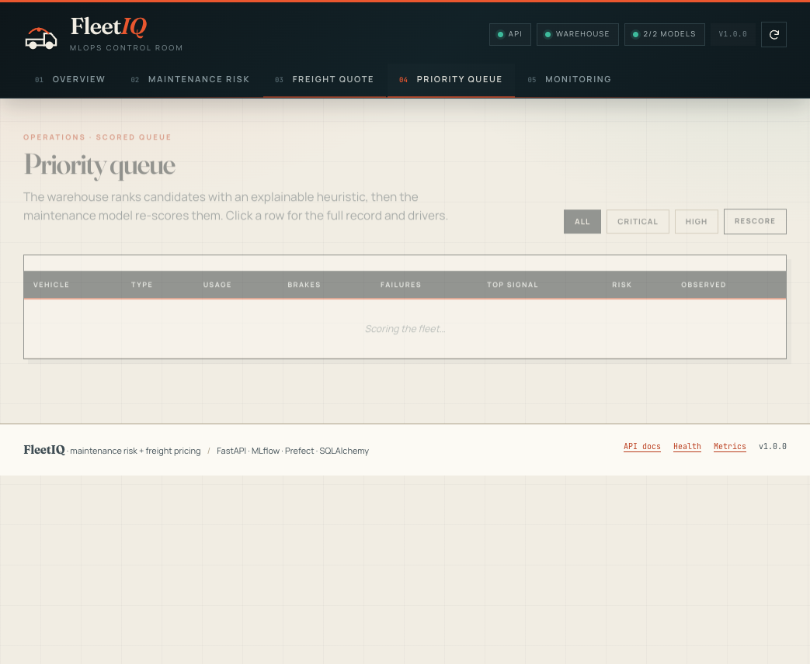
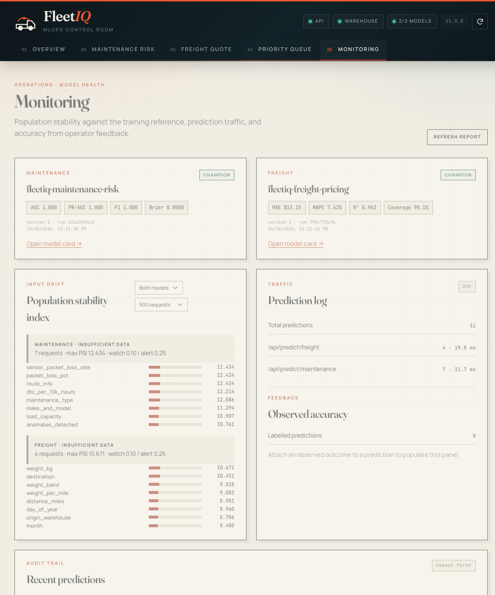

# Dashboard and Design System

The dashboard is a single-page operations console served by FastAPI at `/`. It is plain HTML, CSS, and JavaScript. There is no React, no bundler, and no Node process in production.

That choice is deliberate. The API contract is already typed and documented; the UI only needs to render it. A build step would add deployment surface without improving the product.

## Screenshots

| Overview | Maintenance risk |
| --- | --- |
|  |  |

| Freight quote | Priority queue |
| --- | --- |
|  |  |



---

## 1. Structure

```text
frontend/
├── index.html          # all panels, forms, dialogs
├── styles.css          # design system and layout
├── app.js              # API client, state, renderers, interactions
└── assets/fonts/       # Fraunces, Manrope, JetBrains Mono (WOFF2)
```

FastAPI mounts `frontend/` at `/static` and serves `index.html` for `/`.

### Panels

| Panel | Purpose |
| --- | --- |
| Overview | Fleet KPIs, segment risk, maintenance trend, brake conditions, carrier costs, registry card |
| Maintenance | Telemetry form, sliders, service-note parser, risk result, contributing signals |
| Freight | Quote form, cost interval, lane benchmark, recent shipments |
| Priority | Model-scored vehicle queue, filter, vehicle dialog |
| Monitoring | PSI drift table, traffic summary, feedback metrics, recent events |

A sticky masthead shows API, warehouse, and model status. A status rail and toast notifications handle background refreshes and errors.

---

## 2. Visual language

The goal was an operations console that feels like a printed logistics annual report, not a generic SaaS dashboard.

### Palette

| Token | Hex | Use |
| --- | --- | --- |
| `--paper` | `#f3efe6` | Warm limestone page background |
| `--paper-2` | `#fdfbf5` | Cards and raised surfaces |
| `--paper-3` | `#e8e1d3` | Secondary surfaces |
| `--ink` | `#0e1b20` | Deep petrol text and masthead |
| `--ink-soft` | `#46575e` | Secondary text |
| `--ink-faint` | `#77868b` | Metadata |
| `--accent` | `#ee5a29` | Signal orange, primary actions |
| `--accent-deep` | `#c33f12` | Accessible button background |
| `--teal` | `#0b7f6d` | Healthy / low risk |
| `--amber` | `#b97c0c` | Watch / moderate |
| `--red` | `#b13a2b` | Alert / critical |
| `--blue` | `#2a6089` | Informational |
| `--violet` | `#6b5bb5` | Secondary chart series |

The background uses two radial washes (orange top-left, jade top-right) and a 52 px grid. The grid is subtle enough to read as paper texture, not a developer tool.

### Typography

| Role | Family | Notes |
| --- | --- | --- |
| Display | Fraunces | Variable serif, used for headlines and panel titles |
| UI | Manrope | Variable sans, used for labels, body, controls |
| Data | JetBrains Mono | Tabular numbers, IDs, metrics, timestamps |

All three are bundled as WOFF2 under `frontend/assets/fonts/`. No external font request, no layout shift from a third-party CDN, and no dependency on Google Fonts.

### Surfaces

Cards use a 1 px warm border, a paper-2 fill, and an offset shadow:

```css
box-shadow: 6px 6px 0 rgba(14, 27, 32, 0.09);
```

The hard offset reads as a printed card rather than a floating glass panel. Hover states lift the card slightly and deepen the shadow. The masthead uses a layered petrol gradient with a 3 px orange top rule.

KPI cards are numbered (`01`, `02`, ...) in the corner, which gives the grid an editorial rhythm and makes screenshots easier to discuss.

---

## 3. Components

### Status rail

Three pills: API, Warehouse, Models. Each turns jade when healthy, amber when degraded, red when down. The version pill shows `v1.0.0`.

### Overview hero

A two-column board: a large statement on the left, a dark "control board" on the right with four figures (vehicles scored, maintenance rate, freight MAPE, maintenance ROC AUC) and a note about the active model version.

### KPI grid

Six numbered cards:

1. Vehicles scored
2. Maintenance rate
3. Poor brake vehicles
4. Freight spend
5. Average transit days
6. Prediction traffic (24h)

### Charts

Charts are hand-built with HTML/CSS bars and SVG, not a charting library. That keeps the page light and the visual language consistent. Segment risk, monthly trend, carrier cost, and brake condition each have a dedicated renderer in `app.js`.

### Maintenance form

Two columns:

- **Vehicle context:** make/model, type, model year, route, weather, road, communication interface, telematics gateway, edge device class.
- **Telemetry:** usage hours, load capacity, actual load, fuel, tire pressure, CAN rate, packet loss, historical cost, engine temperature, vibration, battery, oil quality, failure history, anomalies, DTC count, maintenance type, brake condition, service note.

Sliders drive hidden numeric inputs so the form can show a human-friendly control while still submitting exact values. The service note is parsed by the API and rendered as chips for error codes, part numbers, mileage, keywords, and urgency.

### Result card

Shows:

- Risk level with a color-coded badge
- Probability and threshold
- Recommended action
- Top signals with impact bars and direction
- Parsed service note
- Model version, run ID, and prediction ID

### Freight quote

Shows the point estimate, 90% interval, cost per mile, quote validity, lane benchmark (p25 / median / p75), and recent shipments for context.

### Priority queue

A table of the highest-risk vehicles from `/api/vehicles/priority`. Clicking a row opens a dialog with the vehicle profile and live score. The queue is explicitly labelled as a demo because it includes the observed label.

### Monitoring

Drift table with PSI bars, status pills, and a note when the window is too small. Traffic summary, feedback accuracy, and recent events sit below.

---

## 4. JavaScript architecture

`app.js` is organized as a small module with no framework:

```text
state              current options, models, selected vehicle
api(path, opts)    fetch wrapper with JSON parsing and error toasts
loadOverview()     KPIs, charts, registry card
loadOptions()      form selects, lane select, initial benchmark
loadMaintenance()  form submit, result rendering
loadFreight()      quote submit, interval and benchmark rendering
loadPriority()     queue, filter, dialog
loadMonitoring()   drift, traffic, feedback, events
refreshAll()       parallel refresh with per-section error isolation
```

Each panel loads independently. A failed monitoring request does not blank the overview. Errors surface as toasts and in the relevant card.

The API base is relative (`/api`), so the same frontend works locally, in Docker, and behind a path-prefixed proxy.

### Form payload alignment

Request models use `extra="forbid"`. The frontend must send exactly the schema keys. This caught a real bug during development: a mismatch between the form field names and the Pydantic model produced a `422` until the payload builder was corrected.

### Accessibility

- Semantic landmarks: `header`, `main`, `section`, `nav`, `dialog`
- Skip link to `#main`
- Visible focus ring (`3px solid var(--accent)`)
- Labels for every input
- `aria-live` on the KPI grid and result regions
- Dialog focus management and Escape handling
- Color is never the only signal: risk levels also have text labels
- Contrast checked with Lighthouse

Lighthouse on the overview after the palette fixes:

```text
Accessibility     1.0
Best Practices    1.0
SEO               1.0
Performance       (not benchmarked; local data)
```

---

## 5. Running the dashboard

### Local

```bash
python -m src.cli serve --reload
```

Open <http://localhost:8000>.

### Docker

```bash
docker compose up --build -d
```

Open <http://localhost:8000>. The first boot may take a minute while the API ingests the raw CSVs into PostgreSQL.

### Cache busting

Static assets are served normally. After editing CSS or JS, hard-refresh or append a query string:

```text
http://localhost:8000/?v=7
```

---

## 6. Design constraints

- **No external CDN.** Fonts, CSS, and JS are local.
- **No build step.** The files served are the files edited.
- **No chart library.** Charts are CSS/SVG so the bundle stays small.
- **No dark mode.** The warm paper palette is the identity; a dark theme would be a separate design, not an inversion.
- **No generic gradients.** The masthead and hero use layered petrol tones, not purple-blue SaaS gradients.
- **No stock illustrations.** The visual interest comes from typography, grid, numbered cards, and data.

The result is a dashboard that looks intentional at a glance and still behaves like an operations tool: dense, legible, and fast.
